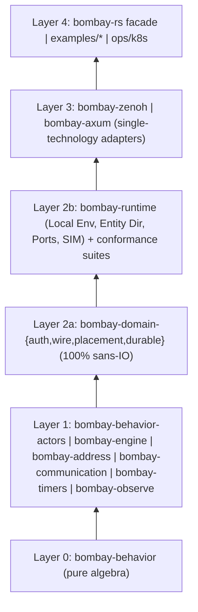

# Bombay Code & Layer Architecture

Scope: Bombay workspace crate layers, bounded contexts, narrow ports, domain vocabulary, error discipline, and mechanical fitness gates.

Status: Target structure accepted by [ADR 0001](../adr/0001-layer-bombay-crates.md). Wave 1 cards (`NIX-01`..`NIX-02`, `DOM-01`..`ADP-02`) apply this extraction before Wave 2–3 feature cards run.

## 1. Empirical Baseline (`main` @ `12c7f008`)

Labels: `EXECUTED` (command ran), `OBSERVED` (source inspected).

| Signal | Measured Value | Evidence |
| :--- | :--- | :--- |
| Workspace Rust size | `71,454` `src` lines; `124,020` `tests` lines | `EXECUTED` (`wc -l`) |
| Intra-crate cycles in `crates/bombay/src` | 6-way strongly connected component: `application <-> remote` (17/8), `application <-> local` (20/5), `application <-> entity` (7/4), `local <-> launch` (30/12), `local <-> terminal` (9/5), `local <-> worker_preparation` (4/3) | `EXECUTED` (`use crate::` graph scan) |
| Foreign SDK leakage | `zenoh*` and `axum` imported directly in `application/{mod,work,http,node}.rs` and `remote/*` | `EXECUTED` (`rg` token scan) |
| Discarded error causes | `23` `map_err(\|_\| ...)` sites | `EXECUTED` (`keep-error-sources` scan) |
| `Ordering::SeqCst` | `164` occurrences | `EXECUTED` (`seqcst-ordering` scan) |
| Slice aversion | `21` `&Vec<T>` / `&String` / `&Box<T>` parameters | `EXECUTED` (`slice-aversion` scan) |
| Temp lock-guard extension | `1` `if let / match / while let ... .lock()` site | `EXECUTED` (`temp-lock-guard` scan) |
| Inline `use` declarations | `693` indented `use` lines inside blocks/tests | `EXECUTED` (`no-inline-use` scan) |

## 2. Five-Layer Pyramid

| Layer | Responsibility | Allowed Dependencies | Forbidden | Verification |
| :--- | :--- | :--- | :--- | :--- |
| **0 Algebra** | Pure `Behavior -> Actions` fold and capability requests | `core` / `std` | I/O, tasks, clocks, channels, locks | Upstream `bombay-behavior` |
| **1 Primitives** | Reusable actor policies, causal `Driver`, address leases, 2-lane mailbox, monotonic timers, completion observation | Layer 0, `parking_lot`, `triomphe` | Tokio network/fs, Zenoh, Axum, Mnesis | Unit, Loom, Miri, fuzz |
| **2a Domain (`sans-IO`)** | Values, wire/grant decoders, replay windows, placement epochs, failover & durable command/outbox/reminder state machines | Layers 0–1, `serde`, `thiserror` | Tokio, `std::fs`/`net`, `Instant::now`, `SystemTime::now`, locks, atomics, cells | Zero-mock unit tests, Hebert FSM `proptest`, `cargo mutants` |
| **2b Runtime Kernel** | Local `Environment`, `Entity` directory, `ApplicationTopology`, static Port traits, `SIM` multi-host host | Layers 0–2a, `tokio` (`rt`, `sync`, `time`) | `zenoh*`, `axum`, `mnesis*`, `selo*` | Deterministic `SIM` & local runtime suites |
| **3 Adapters** | Implement one technology per crate over Layer 2b ports | Layers 0–2b + single technology SDK | Sibling adapters; domain policy rules | Real TLS/HTTP subprocess + port conformance suites |
| **4 Facade & Apps** | Re-export public surface, wire concrete adapters, CLI/K8s manifests | Layers 0–3 | Hidden runtime state machines | End-to-end process & example suites |

## 3. Mechanical Enforcement

1. **Cargo crate graph:** Rejects cross-layer cycles at compile time.
2. **`cargo deny check bans` (`deny.toml`):** Restricts `bombay-zenoh*` and `axum` to their owning Layer 3 adapter crates once Wave 1 (`ADP-01`, `ADP-02`) completes.
3. **Per-crate `clippy.toml`:** Enforces type-resolved `disallowed-types` and `disallowed-methods` in every `bombay-domain-*` crate.
4. **`architecture/check.sh`:** Runs `ast-grep` rule self-tests, Bombay AST rules (`no-inline-use`, `bombay-banned-names`, `domain-is-pure`, `keep-error-sources`, `no-catch-all-modules`, `meaningful-type-names`, `one-name-per-type`), and cognitive complexity ceiling `<= 15`.
5. **`architecture/step.sh` + `architecture/design/facts.sh`:** Enforces lane isolation, `Oracle:` test-assertion custody, `Reuse:` justification (`> 150` added `src` lines), and a hard non-regression ratchet on AST fitness signals unless `Design: <reason>` is recorded.
